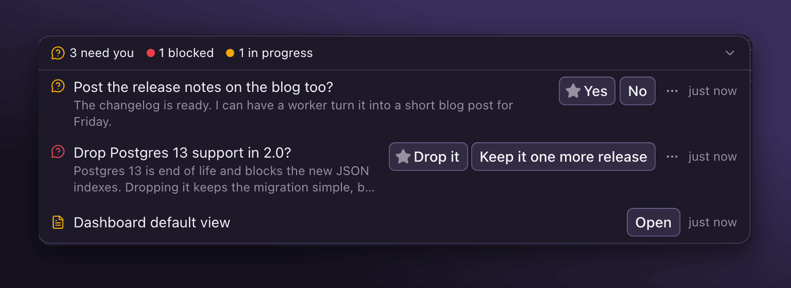
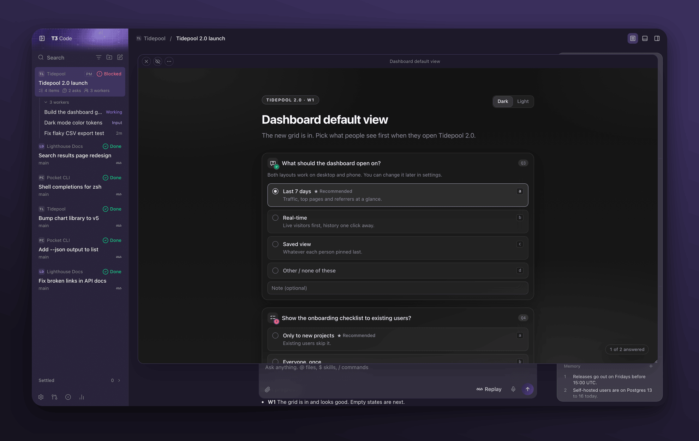
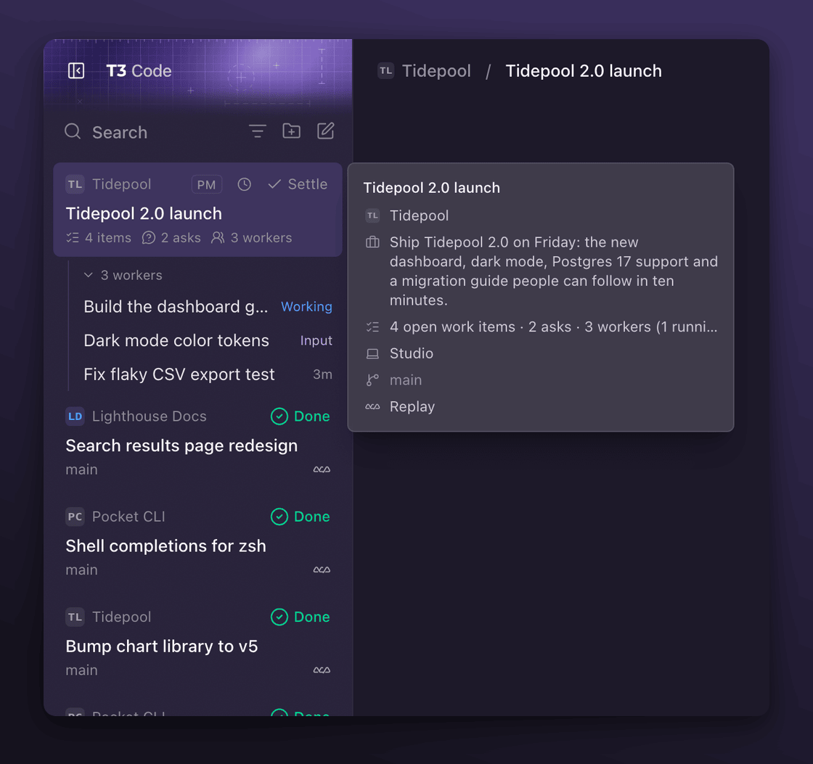
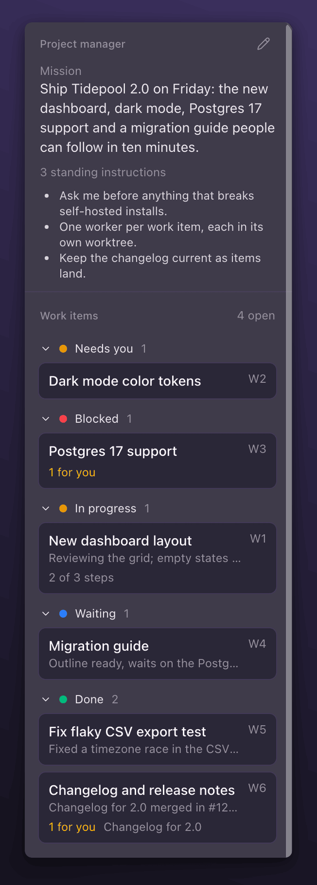

<p align="center">
  
</p>

<h1 align="center">T3 Code PM</h1>

<p align="center">T3 Code with a project manager in your sidebar.</p>

<p align="center">
  <a href="https://github.com/maddada/t3code-pm/releases/latest"><strong>Download</strong></a> ·
  <a href="#install">Install</a> ·
  <a href="#connect-your-phone">Phone</a> ·
  <a href="https://github.com/pingdotgg/t3code">Upstream T3 Code</a>
</p>

<p align="center">
  
</p>

T3 Code PM is an unofficial fork of [T3 Code](https://github.com/pingdotgg/t3code) that adds **Project Manager threads**. You give a PM a brief. It splits the work into items, starts worker threads for them, follows those workers, and comes back to you only when it needs a decision.

Everything else is T3 Code: the same fast app, the same agents, the same subscriptions you already pay for.

## Why a coordinator?

Once you run more than a couple of agent threads, you become the dispatcher. You check which thread finished, which one is stuck on a question, which one went quiet, and what is left to do. A PM does that part for you.

- It keeps the plan: a mission, standing instructions, memory notes, and numbered work items.
- It starts workers with a full brief and hears back from them on its own.
- It asks you numbered questions with one-click answers, and keeps going on everything else.

## What you get

**PM threads.** A PM is a thread in a project's sidebar, next to your other threads. A project can have as many PMs as you like. Each one has a mission, standing instructions and memory you can edit in the details panel.

**Work items.** Every line of work gets a tag (W1, W2, ...) and a status: Needs you, Blocked, In progress, Waiting, or Done. The Work items card in the details panel shows them grouped, with steps, links and what each one waits on.

**Workers that report back.** When a worker finishes, needs an answer, goes quiet for 8 minutes, stops mid-turn, or restarts with the server, its PM gets a report and wakes up. Each report is delivered once, even across restarts.

**A dock of questions.** The PM's questions (Q1, Q2, ...) sit above the chat box. Pick an answer in one click (the PM's pick has a star), or snooze, dismiss, or copy a question's tag.

<p align="center">
  
</p>

**Live pages.** When a question needs more than a button, the PM publishes a page that opens in a pop-up window over the chat. Your choices go straight back to the PM.

<p align="center">
  
</p>

**One sidebar.** A PM's row shows its status and counts, with its workers nested under it. Hover it for the mission and a summary.

<p align="center">
  
</p>

<table>
  <tr>
    <td width="50%" align="center"></td>
    <td width="50%" align="center"></td>
  </tr>
  <tr>
    <td align="center">The details panel: mission, instructions and work items</td>
    <td align="center">The same sidebar at phone width</td>
  </tr>
</table>

**Any agent.** The PM drives its work through T3's MCP tools, so it runs on any agent that gets them: Claude, Codex, Cursor, OpenCode, Pi, Muse Code and ACP agents. Workers can use any agent T3 Code supports.

**One switch.** Settings, Project managers turns the whole feature off (on the phone: Settings, Environments, your environment, Project managers). PM threads then show as normal threads, and nothing is deleted.

## Install

Get the files from the [latest release](https://github.com/maddada/t3code-pm/releases/latest). Like T3 Code, it needs at least one coding agent installed and signed in, such as Claude Code (`claude auth login`) or Codex (`codex login`).

### macOS (Apple Silicon)

1. Download the `.dmg`, open it, and drag **T3 Code PM** to Applications.
2. The app is ad-hoc signed, not notarized, so macOS blocks the first open. Do one of these:
   - Right-click the app in Applications and choose **Open**, then **Open** again.
   - Or try to open it once, then go to System Settings, Privacy & Security, and click **Open Anyway**.
   - Or run `xattr -dr com.apple.quarantine "/Applications/T3 Code PM.app"`.
3. After each update, macOS asks once for the "t3code-pm Safe Storage" keychain item. Choose **Always Allow**.

### Windows (x64)

Download the `.exe` installer and run it. If SmartScreen says "Windows protected your PC", click **More info**, then **Run anyway**.

### Linux (x64)

Download the `.AppImage`, make it executable, and run it:

```sh
chmod +x T3-Code-PM-*.AppImage
./T3-Code-PM-*.AppImage
```

### Android (arm64)

1. Download the `.apk` on your phone and open it. Allow installs from your browser or file manager when Android asks.
2. Or from a computer: `adb install t3code-pm-<version>.apk`.

It installs as **T3 Code PM**, next to the official T3 Code app. Then [connect it to your computer](#connect-your-phone).

### iOS

There is no iOS app. The official T3 Code iOS app can still connect to a T3 Code PM server; PMs show there as plain threads.

## Runs beside T3 Code

T3 Code PM is a separate app with its own name, its own `t3-pm` command, and its own data folder, `~/.t3-pm`. It never reads or writes the official app's `~/.t3`, so you can keep both installed and switch freely.

- **Bring your threads over:** quit both apps, then copy `~/.t3/userdata/statev2.sqlite` into `~/.t3-pm/userdata/`.
- **Go back:** open the official T3 Code. It never saw `~/.t3-pm`, so there is nothing to undo. To take your fork threads with you, copy the same file the other way while both apps are closed. PMs open there as plain threads.
- **Remove it:** delete the app and `~/.t3-pm`.
- **Updates:** the app does not update itself. Download new versions from [Releases](https://github.com/maddada/t3code-pm/releases).

A new PM's first turn runs on Claude Opus at high effort. Each later PM starts on the model the previous one used, and you can change a PM's model in its composer.

## Connect your phone

Connect the Android app over Tailscale or your local network.

1. **Tailscale (recommended):** install it on your computer and phone, and sign both in to the same tailnet. On a local network, make sure both devices are on the same Wi-Fi.
2. **Turn on remote access** in the desktop app: Settings, Connections.
3. **Pair:** in the phone app, tap Add environment and scan the QR code from Settings, Connections. Or enter the computer's address with its port (for example `100.x.y.z:13773`) and a pairing code from the same screen.

Your projects appear, and PMs show in the thread list with their workers. The list button in a PM's header opens its work items, workers, mission and memory.

T3 Connect sign-in does not work in the fork's APK: T3's sign-in only accepts T3's own apps. Use Tailscale or your local network instead.

## Unofficial

This is a personal fork. It is not made or supported by the T3 Code team, so please report fork bugs [here](https://github.com/maddada/t3code-pm/issues), not upstream.

It tracks upstream T3 Code closely and is rebased onto upstream `main` regularly. Everything outside Project Managers is upstream's work: for T3 Code itself, see the [upstream README](https://github.com/pingdotgg/t3code#readme) and [docs](./docs/README.md).

## For developers

```sh
vp i
vp run dev                      # server and web, state in the worktree's .t3
vp run dist:desktop:dmg:arm64   # T3 Code PM for Apple Silicon
scripts/sync-upstream.sh        # rebase onto upstream main and run the checks
```

The free `Replay (dev)` provider has a `pm` scenario that drives the real PM tools without a paid model. The fork keeps its code in `apps/*/src/pm`, `apps/server/src/pm` and `packages/pm`, and marks each small edit to an upstream file with `t3code-pm:`.

- [Development notes](./docs/pm/development.md): building the apps and the APK, syncing with upstream, translations, and data compatibility.
- [PM_DESIGN.md](./PM_DESIGN.md): how PM threads work.

## License

[MIT](./LICENSE), like T3 Code.
