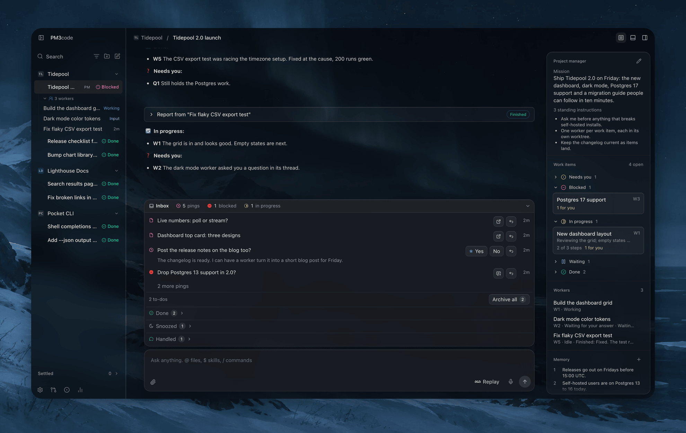
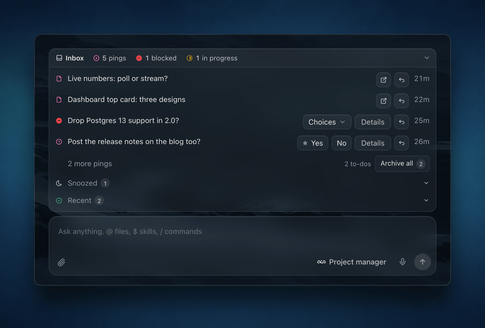
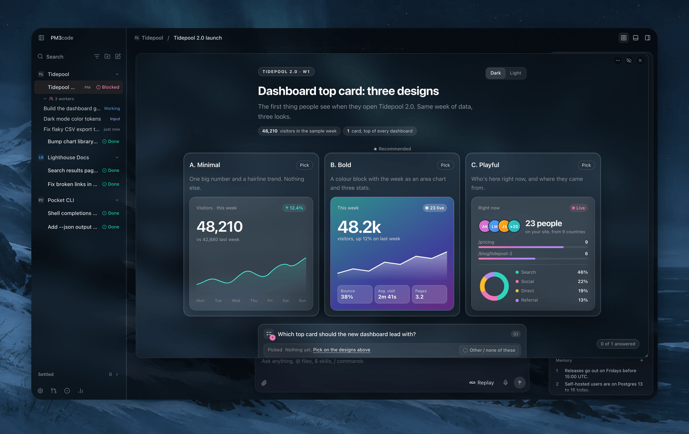
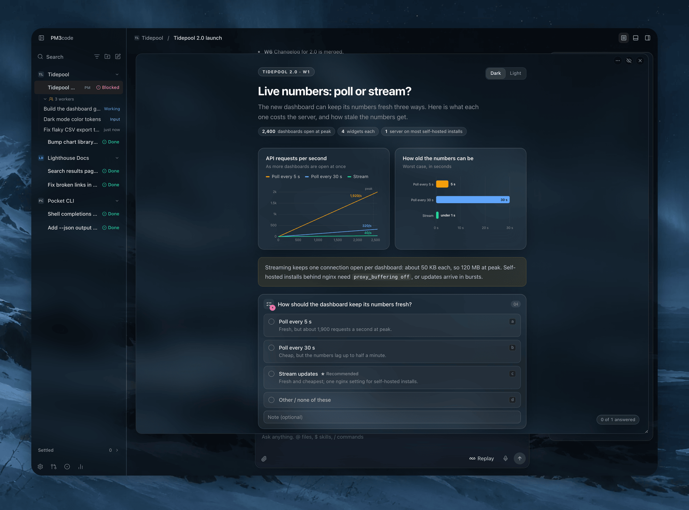
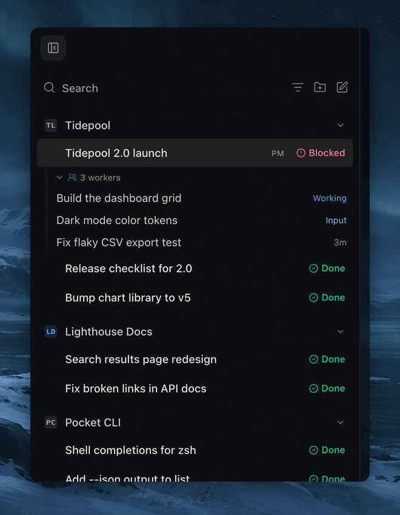
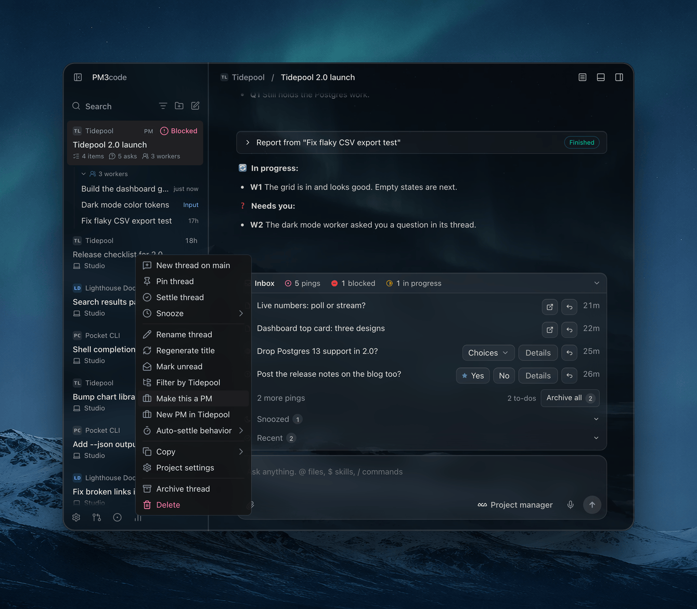
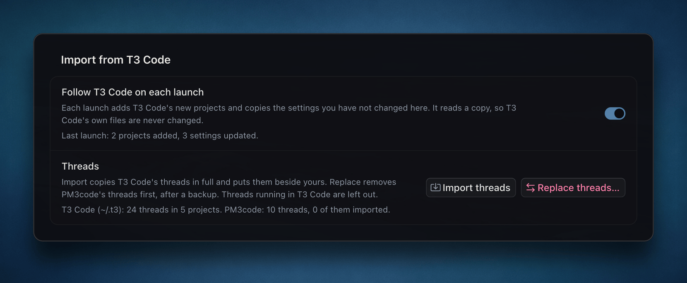

> [!NOTE]
> <b>PM3code sends zero telemetry:</b><br/>
> No analytics, no crash reports, no usage pings and no tracking IDs, from the desktop app, the server, the web app or the Android app. No setting or environment variable turns any of it on. Besides the agents and providers you use, it only makes the few feature calls listed under [Runs beside T3 Code](#runs-beside-t3-code), such as fetching the model list from GitHub.

<h1 align="center">PM3code - PMs Mod for T3code</h1>

<p align="center">T3 Code with project managers in your sidebar.</p>

<p align="center">
  <a href="https://github.com/maddada/pm3code/releases/latest"><strong>Download</strong></a> ·
  <a href="#install">Install</a> ·
  <a href="#connect-your-phone">Phone</a> ·
  <a href="https://github.com/pingdotgg/t3code">Upstream T3 Code</a>
</p>

<p align="center">
  
</p>

PM3code (PMs Mod for T3code) is an unofficial fork of [T3 Code](https://github.com/pingdotgg/t3code) that adds **Project Manager threads**. You give a PM a brief. It splits the work into items, starts worker threads for them, follows those workers, and comes back to you only when it needs a decision.

Everything else is T3 Code: the same fast app, the same agents, the same subscriptions you already pay for.

> We're not trying to create a separate app. This is just a test to let people try [Ghostex](https://github.com/maddada/Ghostex)'s orchestration and inbox workflow inside T3 Code, in an app you can install side by side with regular T3 Code. Ghostex is a Rust-based alternative with the same coordinator workflow.

## How it works

1. **Create one PM per project.**
2. **Ask for options or a triage.** For example: "I want to add feature X. Show me UX options in a Live page", or "Triage all my issues in a Live page".
3. **The page lands in your Inbox**, the area above the chat box, with designs or choices on it.
4. **Make your picks or comments** right on the page.
5. **Click Send to agent** at the end of the page.
6. **The PM starts workers** to do all the assigned work, on the agents you told it to use and by any rules you set. Those rules live in the PM's memory.

> [!TIP]
> Use Live pages to get information back and to make decisions. Reading the chat is a much worse experience.

## Why it's better

**Less thread juggling**

- No more hunting for, snoozing or settling threads. The PM follows its workers and wraps them up for you.
- Far fewer threads get created, because workers nest under their PM. An almost empty sidebar means peace of mind.
- The PM manages all the work. You just prompt and make picks.

**You stay in the loop only where it matters**

- You see a "Needs you" in the sidebar and aren't flooded with updates.
- Jump to that PM whenever you want and make your picks, or snooze what you want to continue later.
- Once you're done testing, tell the PM to cut a release, then go play GTA.
- Tell your PM to send you a Live page first whenever it's going to change the UI, so you pick how it should look. Without this, agents sometimes pick the dumbest UIs.
- Yes, it needs you before it builds, but that beats testing later and finding something ugly. You spend the time either way: adjusting afterwards, or giving your picks up front. Picks up front mean much less going back.

**It gets smarter over time**

- Your PM keeps getting better, because it saves how you like to work in each project.
- Copy chosen memories from one PM to a new one when you want to.
- PM memory beats `AGENTS.md` for this, because it doesn't affect the worker threads.
- A strong model can often write better prompts than you once it understands the product. You get that for free, because the PM rewords your asks before it starts or messages a worker.

**It spreads the work**

- The PM picks the agent for each piece of work, based on the rules you set, such as which agent has usage left.
- The PM stays idle after it hands work to its workers and relays their status, Live pages and questions back to you. So you can always send it more asks, however unrelated.

## Why a coordinator?

Once you run more than a couple of agent threads, you become the dispatcher. You check which thread finished, which one is stuck on a question, which one went quiet, and what is left to do. A PM does that part for you.

- It keeps the plan: a mission, standing instructions, memory notes, and numbered work items.
- It starts workers with a full brief and hears back from them on its own.
- It asks you numbered questions with one-click answers, and keeps going on everything else.

## What you get

**PM threads.** A PM is a thread in a project's sidebar, next to your other threads. A project can have as many PMs as you like. Each one has a mission, standing instructions and memory you can edit in the details panel.

**Work items.** Every line of work gets a tag (W1, W2, ...) and a status: Needs you, Blocked, In progress, Waiting, or Done. The Work items card in the details panel shows them grouped, with steps, links and what each one waits on.

**Workers that report back.** When a worker finishes, needs an answer, goes quiet for 8 minutes, stops mid-turn, or restarts with the server, its PM gets a report and wakes up. Each report is delivered once, even across restarts.

**An Inbox above the chat box.** The PM's questions (Q1, Q2, ...), its Live pages and its blocked work sit above the chat box, with counts at the top. Pick an answer in one click (the PM's pick has a star), snooze a row, or archive finished to-dos all at once. The Snoozed drawer keeps what you put off, and the Recent drawer below it keeps what the PM finished and what you already answered.

<p align="center">
  
</p>

**Live pages.** When a question needs more than a button, the PM publishes a page that opens in a pop-up window over the chat. Your choices go straight back to the PM.

<p align="center">
  
</p>

<p align="center">
  
</p>

**One sidebar.** A PM's row shows its status and counts, with its workers nested under it. Hover it for the mission and a summary.

<p align="center">
  
</p>

<table>
  <tr>
    <td width="50%" align="center"></td>
    <td width="50%" align="center"></td>
  </tr>
  <tr>
    <td align="center">The details panel: mission, instructions and work items</td>
    <td align="center">The same sidebar at phone width</td>
  </tr>
</table>

**Make this a PM.** Any thread can become a Project Manager: right-click it in the sidebar, or use the thread menu or the command palette. It keeps its history, agent and model, and has the PM's tools from its next turn. **Turn back into a normal thread** undoes it.

<p align="center">
  
</p>

**Import from T3 Code.** Each time PM3code starts, it adds T3 Code's new projects and copies the settings you haven't changed in PM3code. It reads a copy, so it never writes to `~/.t3`. In Settings, Project managers, you can turn this off, import T3 Code's threads beside yours, or replace yours with them after a backup.

<p align="center">
  
</p>

**Any agent.** The PM drives its work through T3's MCP tools, so it runs on any agent that gets them: Claude, Codex, Cursor, OpenCode, Pi, Muse Code and ACP agents. Workers can use any agent T3 Code supports.

**One switch.** Settings, Project managers turns the whole feature off (on the phone: Settings, Environments, your environment, Project managers). PM threads then show as normal threads, and nothing is deleted.

**The Ghostex look.** PM3code starts on Ghostex, its built-in theme of frosted glass over Ghostex's Polar Night art, first-run setup included. Pick another theme in Settings, Appearance, and pick **Ghostex** there to come back; a theme you already chose stays. Web and desktop only. On PM3code 0.2.2 and older, paste [pm3code-ghostex.css](./docs/pm/theme/pm3code-ghostex.css) instead: **Create theme**, set it to Dark, open **Custom CSS**, paste the file, set **Accent** to `#5581A9`, and create the theme.

## Install

Get the files from the [latest release](https://github.com/maddada/pm3code/releases/latest). Like T3 Code, it needs at least one coding agent installed and signed in, such as Claude Code (`claude auth login`) or Codex (`codex login`).

After installing, the desktop app keeps itself up to date (see [Updates](#updates)).

Releases up to 0.2.0 were called T3 Code PM, and their files and app are named `T3-Code-PM-*` and **T3 Code PM**. Newer ones keep the same data, so updating from them loses nothing. On macOS, delete the old **T3 Code PM** app from Applications after installing **PM3code**.

### macOS (Apple Silicon)

1. Download `PM3code-<version>-arm64.dmg`, open it, and drag **PM3code** to Applications. It's signed and notarized by Apple, so it opens like any other app.
2. The first time it starts, macOS asks for the "t3code-pm Safe Storage" keychain item. Choose **Always Allow**. Updates are signed the same way, so macOS doesn't ask again after one.

Releases up to 0.2.1 aren't notarized, so macOS blocks their first open: right-click the app in Applications and choose **Open**, or go to System Settings, Privacy & Security, and click **Open Anyway**.

### Windows (x64)

1. Download `PM3code-<version>-x64.exe` and run it. The installer isn't signed, so if SmartScreen says "Windows protected your PC", click **More info**, then **Run anyway**. Updates the app downloads itself install without that prompt.
2. It installs for your user only, into `%LOCALAPPDATA%\Programs\t3code-pm`, and adds **PM3code** to the Start menu. Remove it from Settings, Apps, Installed apps, where it has its own **PM3code** entry.

### Linux (x64)

Download `PM3code-x86_64.AppImage` (`PM3code-<version>-x86_64.AppImage` up to 0.2.4), make it executable, and run it:

```sh
chmod +x PM3code-*x86_64.AppImage
./PM3code-*x86_64.AppImage
```

Updates replace the AppImage file in place, so keep it somewhere you can write to.

On Ubuntu 22.04 and later, AppImages need FUSE 2 first: `sudo apt install libfuse2t64` (`libfuse2` on 22.04). On first launch it registers its own `t3code-pm://` handler and launcher entry, and never replaces T3 Code's.

### Android (arm64)

1. Download the `.apk` on your phone and open it. Allow installs from your browser or file manager when Android asks.
2. Or from a computer: `adb install PM3code-<version>-arm64.apk`.

It installs as **PM3code**, next to the official T3 Code app. Then [connect it to your computer](#connect-your-phone).

### iOS, and the official phone apps

There is no PM3code iOS app. The official T3 Code apps for iPhone and Android can pair with a PM3code computer over Tailscale or your local network, the same way as [the fork's APK](#connect-your-phone) (QR code, or address and pairing code), and use normal threads. PMs and their workers show there as ordinary threads, with no Inbox or work items. T3 Connect sign-in and push notifications don't work with a PM3code computer.

### Updates

From the release after 0.2.4, the desktop app checks [PM3code's releases](https://github.com/maddada/pm3code/releases) at launch and every four hours. A new version shows on the update button at the bottom of the sidebar: click it to download, and a notice says when **PM3code &lt;version&gt; is ready**. **Restart** installs it; **Later** keeps it on the update button for when you're ready. Check by hand with **PM3code > Check for Updates...** (**Help > Check for Updates...** on Windows and Linux) or Settings, About. Turn the automatic checks off under Settings, Maintenance, Updates, **Check for app updates automatically**.

Installs of 0.2.4 and older don't update themselves: install the next release by hand once. The Android app doesn't update itself either.

## Runs beside T3 Code

PM3code installs as its own app, with its own name, its own `t3-pm` command, and its own data folder, `~/.t3-pm`. It never reads or writes the official app's `~/.t3`, so you can keep both installed and switch freely.

- **Bring your threads over:** quit both apps, then copy `~/.t3/userdata/statev2.sqlite` into `~/.t3-pm/userdata/`.
- **Go back:** open the official T3 Code. It never saw `~/.t3-pm`, so there is nothing to undo. To take your fork threads with you, copy the same file the other way while both apps are closed. PMs open there as plain threads.
- **Remove it:** delete the app and `~/.t3-pm`.
- **Updates:** the desktop app updates itself from PM3code's own releases, never T3 Code's. See [Updates](#updates).
- **Network:** besides your agents and providers, PM3code fetches the model list and token prices from GitHub, checks PM3code's GitHub releases for a new desktop version (only the release files, with no ID; turn it off under Settings, Maintenance, Updates, **Check for app updates automatically**), checks your agents' download sites for new versions (turn that off in the same section), and reaches Open VSX only when you browse themes. Links in chats show a generic icon, so no favicon service sees which sites you discuss. Logs and traces stay in files on your machine; nothing is exported over OpenTelemetry, whatever `OTEL_*` or `T3CODE_OTLP_*` variables say.

A new PM's first turn runs on Claude Opus at high effort. Each later PM starts on the model the previous one used, and you can change a PM's model in its composer.

## Connect your phone

Connect the Android app over Tailscale or your local network.

1. **Tailscale (recommended):** install it on your computer and phone, and sign both in to the same tailnet. On a local network, make sure both devices are on the same Wi-Fi.
2. **Turn on remote access** in the desktop app: Settings, Connections.
3. **Pair:** in the phone app, tap Add environment and scan the QR code from Settings, Connections. Or enter the computer's address with its port (for example `100.x.y.z:13773`) and a pairing code from the same screen.

Your projects appear, and PMs show in the thread list with their workers. The list button in a PM's header opens its work items, workers, mission and memory.

T3 Connect sign-in does not work in the fork's APK: T3's sign-in only accepts T3's own apps. Use Tailscale or your local network instead.

## Unofficial

This is a personal fork. It is not made or supported by the T3 Code team, so please report fork bugs [here](https://github.com/maddada/pm3code/issues), not upstream.

It tracks upstream T3 Code closely and is rebased onto upstream `main` regularly. Everything outside Project Managers is upstream's work: for T3 Code itself, see the [upstream README](https://github.com/pingdotgg/t3code#readme) and [docs](./docs/README.md).

## For developers

```sh
vp i
vp run dev                      # server and web, state in the worktree's .t3
vp run dist:desktop:dmg:arm64   # PM3code for Apple Silicon
scripts/sync-upstream.sh        # rebase onto upstream main and run the checks
```

The free `Replay (dev)` provider has a `pm` scenario that drives the real PM tools without a paid model. The fork keeps its code in `apps/*/src/pm`, `apps/server/src/pm` and `packages/pm`, and marks each small edit to an upstream file with `t3code-pm:`.

- [Development notes](./docs/pm/development.md): building the apps and the APK, syncing with upstream, translations, and data compatibility.
- [PM_DESIGN.md](./PM_DESIGN.md): how PM threads work.

## License

[MIT](./LICENSE), like T3 Code.
